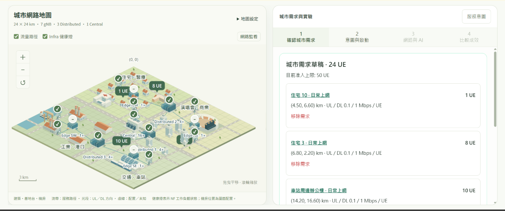
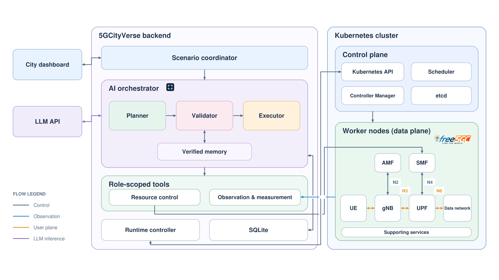

# 5GCityVerse

5GCityVerse is a 5G network experimentation platform that combines smart city scenarios, an AI orchestrator, and free5GC. City events create simulated UEs and traffic so operators can observe network behavior under different service requirements and experiment with AI driven resource changes.



## Main features

- **City scenarios and visualization:** Present eMBB, URLLC, mMTC, and V2X demand through city events, with UE, traffic, and execution status.
- **Three AI roles:** The Planner analyzes observations and proposes strategies; the Validator checks proposals, effects, and restoration; the Executor applies or restores validated strategies.
- **free5GC integration:** free-ran-ue simulates access and UEs. AMF, SMF, and UPF establish the data path, while the project's SMF QER API adjusts QoS for existing sessions.
- **Observability and records:** Combine Kubernetes, native QER, and receiver traffic evidence with checkpoints and verified lessons.

## Architecture



## On-prem deployment

### Prerequisites

On Ubuntu 24.04 with an existing Kubernetes cluster, install:

- Bash and Git
- Python 3.10+ with `pip`, `venv`, and PyYAML
- Node.js 22.12+ with npm
- `kubectl` and Helm 3

See the [infrastructure guide](infrastructure/onprem/README.md) for host preparation and the [startup guide](scripts/onprem/README.md) for the backend environment.

### AI API key

1. Copy `.env.example` to `.env`.
2. Set `OPENAI_API_KEY`.

### Deploy the network

Run from the repository root on Ubuntu. Prepare Kubernetes and Helm using the [infrastructure guide](infrastructure/onprem/README.md), and the Python environment using the [startup guide](scripts/onprem/README.md).

1. Generate deployment files using [value.yaml](infrastructure/onprem/value.yaml).

   ```bash
   bash infrastructure/onprem/scripts/render.sh
   ```

2. Prepare native network settings.

   ```bash
   sudo "$HOME/.venvs/5gcityverse-onprem/bin/python" -m backend.onprem.operations.deployment.native_runtime --apply
   ```

3. Use the output directory printed in step 1, then install with Helm from the repository root.

   ```bash
   read -r -p "Render output directory: " RENDER_DIR
   sudo helm --kubeconfig /etc/kubernetes/admin.conf upgrade --install cityverse "$RENDER_DIR/cityverse-onprem-0.2.0.tgz" \
     -n free5gc-onprem --create-namespace -f "$RENDER_DIR/values-01.yaml" \
     -f /var/lib/cityverse/operator-native/bootstrap-values.json \
     --post-renderer infrastructure/onprem/scripts/post-render.sh
   ```

### Remove the network

1. Uninstall the Helm release.

   ```bash
   sudo helm --kubeconfig /etc/kubernetes/admin.conf uninstall cityverse -n free5gc-onprem
   ```

2. To also remove namespaces, PV definitions and host interfaces, follow the [complete cleanup commands](infrastructure/onprem/README.md#shutdown-and-remove-the-project-network). Local data is retained.

### Start the frontend and backend

1. Install frontend dependencies.

   ```bash
   npm --prefix frontend ci
   ```

2. Start both services.

   ```bash
   bash scripts/onprem/start-onprem.sh
   ```

3. Stop both services.

   ```bash
   bash scripts/onprem/stop-onprem.sh
   ```

Defaults: backend `http://127.0.0.1:8000`, frontend `http://127.0.0.1:5173`.

For native 5G integration, custom state files and resource controllers, use the [startup guide](scripts/onprem/README.md).
