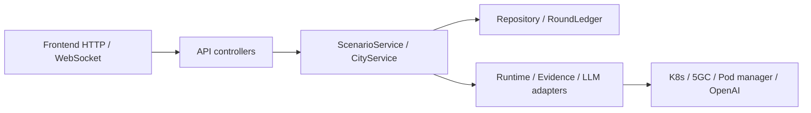

# On-prem backend

The on-prem city simulation backend handles scenario demand, UEs, native traffic, and the AI policy loop. It is a **modular monolith**: one backend process with explicit responsibilities. Adapters connect it to Kubernetes, the 5G core, Pod managers, and LLMs.

## Architecture



- **Application factory:** `api.app.create_app()` creates an app. Tests can inject an isolated context.
- **Composition root:** `ApplicationContext` assembles services, stores, and adapters and owns the admission lock, coordinator, and startup/shutdown lifecycle. Separate app instances do not share mutable module-level execution state.
- **Controller → Service → Repository:** Controllers translate HTTP, services implement admission and use cases, and repositories persist data.
- **Adapters:** Kubernetes, native evidence, QER, LLM, and Pod management use external adapters. API routes do not directly run `kubectl` or change QER.

External API paths, error shapes, UE limits, and native ownership checks remain. `server.py` is the startup entry point rather than the location of routes, database implementations, or service assembly.

## Modules

| Path | Responsibility |
| --- | --- |
| `api/` | App factory, controllers, HTTP errors, and session translation. `server.py` preserves ASGI and CLI startup compatibility. |
| `application/context.py` | Compose services, admission locks, lifecycle, maintenance isolation, and recovery order. |
| `application/providers.py` | Assemble native coordinator, traffic manager, observation and policy adapters, and startup checks. |
| `application/scenarios.py` | Round queries, start and cancel, UE changes, idempotency, and resource conflicts. |
| `application/topology.py` | Observe component health independently every 15 seconds and retain time- and round-scoped history. |
| `evidence/topology.py` and `api/topology.py` | Map Pod readiness from an explicit K8s namespace to gNB, NF, UPF, and N6 nodes; expose read-only current and historical views. |
| `application/city.py` | City events, status broadcast, network reads, daily observations, and AI trends. |
| `application/views.py` and `errors.py` | Public read models, time/status conversion, and application errors. |
| `application/catalog.py` | City scenario catalog through explicit package imports without changing global `sys.path`. |
| `storage/` | Event JSON repository, production round ledger, AF callback store, read-only generation reader, cross-process locks, and recovery guard. |
| `scenarios/` | Demand and slice allocation, coordinator lifecycle, and frontend status projection. See the [Scenarios README](scenarios/README.md). |
| `scenarios/service_requirements.py`, `scenarios/sla.py`, `evidence/sla.py` | Freeze user requirements, read native receiver windows, and deterministically evaluate per-UE, service, and slice SLA. Keep requested targets, measured results, and policy effects separate. |
| `traffic/` | Traffic planning and measurement, batch scheduling, iperf capability, Pod worker contracts, socket tuning, and control transports. See the [Traffic README](traffic/README.md). |
| `capacity/` | Calibration, performance and integrity verdicts, receipts, and existing verified grants. It does not start traffic or change public request limits. |
| `agents/` | LangGraph Planner, Executor, and Validator, phase tools, observations, and memory. See the [Agents README](agents/README.md). |
| `policy/` | Native QER adapters, policy identity, shared errors, quarantine, and PCF absence. See the [Policy README](policy/README.md). |
| `validation/` | Normal and constrained acceptance fixtures, installation, native readback, ownership, and restoration. See the [Validation README](validation/README.md). |
| `runtime/` | Production UE controller, kubeadm/FRU drivers, native scenario resources, city bootstrap, Pod manager, topology defaults, and shared errors. See the [Runtime README](runtime/README.md). |
| `evidence/` | Native AMF, SMF, UPF, and RAN evidence, identity alignment, measurement receipts, throughput A/B interpretation, and read-only ownership. |
| `integrations/` | OpenAI and NF OAM interfaces. |
| `traffic_manager/` | Resident Go manager that controls iperf3 through persistent HTTP connections. See its [README](traffic_manager/README.md). |
| `operations/` | Recovery, diagnostics, validation, and subscriber provisioning CLIs. See the [Operations README](operations/README.md). |
| `settings.py` | API environment, state paths, CORS, and default project `.env` loading. |

Historical generation-specific, fixed commissioning, kind-runtime, N5, and frozen-oracle implementations reside under `archive/legacy/`. The production runtime does not load them on normal startup. Existing incomplete recovery markers and persisted schema fields remain recognized so moving code cannot bypass ownership or cleanup.

## Main service API

A partial constrained-policy installation failure creates an independent `PartialFixtureRecovery` compensation record from saved original QER values. `validation/partial.py` verifies complete restoration while retaining the failed or uncertain write. This follows round cancellation and cleanup; it adds no public unblock endpoint.

Errors generally use `{"error": "CODE", "detail": "..."}`. Bootstrap retains its nested error shape. GET routes also support HEAD.

| Method | Path | Purpose |
| --- | --- | --- |
| GET | `/health` | Backend and environment status; read `ok` to determine readiness, not HTTP 200 alone. |
| GET | `/api/runtime/status` | Runtime, AI, and dependency status. |
| GET | `/api/onprem/bootstrap` | City infrastructure and UE baseline status. |
| POST | `/api/onprem/bootstrap/start` | Start the city bootstrap configured by the environment. |
| GET | `/api/onprem/ue`, `/api/onprem/ue/status` | Actual UE observations and progress; the paths are aliases. |
| GET | `/api/onprem/topology` | Background-observed node health. GET does not query K8s again. `at`, `roundId`, and `generation` select historical observations. |
| POST | `/api/onprem/ue` | Set UE counts for four slices, totaling 0–100; zero stops demand. |
| GET | `/api/onprem/scenario-rounds/current?view=full\|summary` | Current round, measurement and cleanup state, and available capabilities. |
| POST | `/api/onprem/scenario-rounds` | Submit single or mixed scenario traffic demand, totaling 1–100 UEs, with strategy `ai` only. |
| GET | `/api/onprem/service-profiles` | Generator capabilities and existing traffic defaults, without default SLA targets. |
| POST | `/api/onprem/scenario-rounds/preview` | Read-only UL/DL demand, minimum throughput, and generator limit preview; no UE allocation, model call, or policy write. |
| GET | `/api/onprem/scenario-rounds/{round_id}/sla` | Evaluate frozen requirements against historical native evidence without new measurement. |
| GET | `/api/onprem/scenario-rounds/{round_id}/observation-view?after=0&limit=100` | Consistent persisted observability and paged measurements with original timestamps and receipt checks. Earlier separate read routes remain. |
| GET | `/api/onprem/scenario-rounds/{round_id}/measurement-timings?after=0&limit=10` | Read-only internal timing for completed batch measurements, up to 20 windows per page. |
| POST | `/api/onprem/scenario-rounds/{round_id}/cancel` | Cancel a round through native coordinator cleanup. |
| POST | `/api/scenario/trigger`, `/events/trigger` | Legacy event entry points; kubeadm mode rejects them in favor of scenario rounds. |
| GET | `/events/status/{execution_id}` | Event status for the current browser session. |
| POST | `/events/status/{execution_id}/traffic-rendered` | Frontend acknowledgment that evidence-backed traffic was rendered. |
| POST | `/events/reset` | Legacy event cleanup; kubeadm mode uses round cancellation. |
| GET | `/events/reset/{reset_id}` | Cleanup task status for the current browser session. |
| GET | `/network/slices` | Slice status. |
| GET | `/metrics/current` | Current network metrics. |
| GET | `/free5gc/status` | 5GC status and network snapshot. `includeDaily=false` omits separate daily observations; omitted or true returns the full response. |
| GET | `/api/onprem/daily-observation` | Native observation summary with UE identities masked. |
| POST | `/api/onprem/daily-trend` | AI trend from fresh, internally consistent observations. |
| WS | `/ws?sessionId=...` | Runtime, UE, and event status updates. |

A round's `events` always has integer `concert`, `typhoon`, `accident`, `medical`, and `iot_surge` fields; unused values are zero. It also includes `requestId`, `baselineUes`, and `strategy`. Repeating a request with the same ID and body is idempotent; changing the body for the same ID returns 409.

QoS requests may include `serviceRequirements` for per-UE UL/DL offered load, minimum per-UE or service throughput, mean RTT and loss limits, evaluation duration, required pass fraction, and optional slice aggregate targets. The Planner reads frozen requirements and deterministic SLA. Memory is isolated by requirement version and retains post-decision SLA summaries. **Native RTT probes still use adjacent windows, so they do not establish same-window latency SLA. Continuous long-duration SLA has not passed live verification.**

Topology health is sampled by an independent background observer every 15 seconds in an explicit context and namespace. Browser requests and GET do not trigger resampling. `observedAt` retains source time; stale observations older than 30 seconds or failed reads are unknown. This is **K8s Pod readiness**, not NGAP, PDU, QER effect, or SLA proof. `topology-health.sqlite3` keeps up to 24 hours or 5,760 records alongside the round database. Historical reads require matching round, generation, and time; missing history is never synthesized.

Browser events use `X-CityVerse-Session-Id`, then `X-Session-Id`, or `local-session` if neither is provided. The public event query does not expose session identity.

### Internal listeners

These are not public routes of the main service; deployment controls startup and exposure.

| Module | API | Purpose |
| --- | --- | --- |
| `api/policy_callback_asgi.py` | `GET /health`, `GET/POST /admin/actions/{id}`, `POST /notifications/{id}/{token}`, `GET /internal/recovery-fence` | AF callback with management credentials, real PCF peer, and recovery fence checks. |
| `api/evidence_endpoint.py` | `GET /healthz`, `GET /v1/evidence` | Read-only in-Pod RAN/AMF evidence. |
| `traffic_manager/` | `GET /healthz`, `POST /v1/control` | Resident in-Pod traffic control with token and Pod/container identity checks. |

## Development and verification

1. Add API translation to an existing controller; put business rules in the relevant service.
2. Put external operations in existing adapters and writes in a repository or ledger.
3. Inject dependencies in `ApplicationContext` or `providers.py`. Do not introduce mutable server globals or name production features after test generations.
4. Verify HTTP and WebSocket inputs, outputs, state changes, and errors in `test/api/`. Put shared fixtures in `conftest.py`, not other `test_*.py` files.

Run from the project root:

```sh
python -m backend.onprem.api.server
python test/api_regression.py --output .tmp/api-regression-new
```

`uvicorn backend.onprem.api.server:app` remains supported. API regression uses temporary stores and external adapter doubles; it does not start WSL, K8s, iperf3, or a paid model. Run subsystem tests individually as needed. Live UE, LLM, QER effect, and cleanup acceptance require explicit E2E runs; an API pass alone is not that evidence.

Subscriber provisioning uses `python -m backend.onprem.operations.provisioning.subscribers`. Network diagnostics and acceptance tools live in `operations.diagnostics` and `operations.validation`. Historical incident tools are invoked explicitly from `archive.legacy.operations.recovery`.

## Persistent scenarios and evaluation queue

A scenario has no overall execution-seconds limit. The production AI runtime runs at most five evaluation cycles, after which the coordinator maintains selected UEs, traffic configuration, and verified policy. Native traffic continues in bounded receiver windows with identity, freshness, and cleanup checks. API regression does not prove uninterrupted physical traffic.

| Module | Responsibility |
| --- | --- |
| `storage/scenario_queue.py` | Durable FIFO, full requests, request-ID deduplication, dispatch recovery, and independent evaluation progress in the round SQLite database. Two tables were added without changing the native ownership fence. |
| `application/scenario_queue.py` | One dispatcher waits for old-scenario stop, native release evidence, and task completion before starting the next request. |
| `application/scenarios.py` | Submission limits, queued cancellation, and three-state API projection. |
| `agents/observations.py` | Planner CPU and memory values, requests and limits, provenance, and missing values; shared NFs are not attributed to one slice. |

`current.lifecycle` separates `scenarioState`, `evaluationState`, `resourceState`, and `cyclesCompleted/maximumCycles`. Completed evaluation does not imply resource release. New requests during construction or release return 409 `ENVIRONMENT_PREPARING`, while an identical accepted request can still be recovered. New requests during execution get a `cityverse.scenario-submission/v1` receipt; the FIFO does not overwrite active demand.

| API | Purpose |
| --- | --- |
| `GET /api/onprem/scenario-rounds/queue` | Pending, dispatching, and blocked items with positions. |
| `GET /api/onprem/scenario-rounds/queue?requestId=...` | Recover the original submission receipt, including started, completed, or canceled status. |
| `POST /api/onprem/scenario-rounds/queue/{queueId}/cancel` | Cancel an item that has not started; use round cancellation after start. |
| `GET /api/onprem/scenario-rounds/{roundId}/resources` | Read-only structured resource snapshot for the current scenario; historical rounds do not inherit current CPU/memory. |

Restart first recovers or cleans up the old round, then checks whether a dispatching request already has a native reservation before returning it to queued state. Full waiting configurations remain. This does not promise uninterrupted traffic across restarts or in-place continuation of a completed graph.

## Current-state reads and timing

Live control uses current UE and policy state and the latest complete measurement cohort, not every historical report. `storage/live_state.py` maintains `round_live_state` in the rounds transaction, with triggers that also cover offline writers. Startup backfills only the current round. If the index is absent or incompatible, reads derive fresh state through SQL; read-only legacy databases are not modified. Original records remain available for recovery and audit.

AI observers, current readers, QER adapters, ownership and batch control, current API views, summaries, and resource reads use current state. Frontend `observation-view` requests `view=current`; historical queries retain `view=history` and the legacy default. Current reads load only the latest window or full latest cohort, with scope, hash, reference, cohort, and original `observedAt` checks. A recent failure cannot fall back to an older success. Unresolved maintenance markers still block operations. Full history, recovery, and general audit readers retain complete validation.

Set `CITYVERSE_HTTP_TIMING_FILE` to an absolute JSONL path to enable `api/timing.py` HTTP timing; it is off by default. Files rotate at 8 MiB with two retained versions. The middleware records method, path, status, request ID, source time, `applicationMs` before response headers, `totalMs` for the ASGI response, and completion/failure status. For the current-round route it records only allowlisted `full` or `summary` request views, `full` when omitted, or `invalid`. It does not store raw queries, headers, or bodies, and does not time WebSocket messages. Responses expose `X-CityVerse-Request-Id` and `Server-Timing: app;dur=...` for the browser. A diagnostic write failure cannot turn a completed API mutation into failure.

`traffic/timing.py` records per-window monotonic `MeasurementTiming` spans across planning, identity/capability preparation, intent persistence, shard start, readiness, synchronized start, release, SEALED waits, collection, decoding, native postflight, checkpoint, cleanup, freshness, adoption, and publication. It records relative start, duration, success/error, shard, and control role/queue timing. Transport timing separates Pod pre-read, remote request, and post-read; it cannot measure time inside a Pod or kernel.

`storage/measurement_timings.py` stores optional diagnostics in a `<stem>.measurement-timings.sqlite3` sidecar next to the round database. A lazy background writer starts only when needed; constructing the app, importing modules, or GET requests do not create a thread or file. Diagnostics are queued after native workers finish and adoption or failure is decided, so they do not consume evidence freshness before acceptance. Limits are eight queued records plus one in progress, 512 KiB per record, the latest 64 windows, 64 MiB in SQLite pages, and 2,048 spans per window with explicit `droppedSpans`. Queue overflow or persistence failure does not rewrite native results or cleanup. Pending diagnostics may be lost on process crash; required native checkpoints retain their own durability rules.

The timing API pages sidecar `items / nextCursor / hasMore` using `after`. Legacy round-table timings are separately paged under `legacy` using `legacyAfter`; cursors cannot be mixed. Poll summaries group successful status polling by phase, shard, and role, with counts, duration, range, queue/dispatch totals, and two sample spans. Errors keep separate spans. Nested and parallel parent, shard, control, and transport spans must not be added as if sequential. These diagnostics do not prove QER or traffic effects.

## Verification status and limitations

A deployed R91 normal 50-UE run on 2026-10-26 completed **five evaluation cycles** with native result windows of 39.594, 39.489, 39.817, 42.165, and 40.959 seconds. All five AI cycles held policy and made zero QER writes. This verifies the normal hold path for that run; it does not demonstrate a QER improvement. The original harness summary failed an outdated full-action equality check; a later exact current-view comparison and full-journal audit passed independently, while the original failed summary remains unchanged.

**Production release acceptance did not pass.** A constrained run completed only 1/5 cycles before `plan.hold_has_policy_arguments`. The fixture's outer restoration compared a 17-action full snapshot with an 11-action current view and stopped before an attempt. A manual continuation through the existing intent and ownership protocol restored 50 original rates and released the fixture; that closed the run but was not a deployed product fix.

A 60-minute endurance test stopped at 427 seconds when RSS rose by about 472 MiB (from 2.62 to 3.08 GiB), beyond the preset 300 MiB guard. Fifty UEs remained active, successful windows grew from 6 to 14, no measurement failed, and no OOM was observed. This does not alone prove a memory leak. An isolated current-only read used less time and peak memory than a full-history read, but it is not a complete service heap profile.

Restart acceptance killed the app during a real result measurement. The same release recovered and verified cleanup of the old round; it did not resume that execution. A new 50-UE round completed one real AI cycle and was explicitly stopped. Final fleet, allocation, queue, Pod, fixture, PCF absence, quarantine, and health checks passed. The release remained R91 at the time of the record.

A later **local, undeployed** current-only change removed full-history `RoundLedger.current()` reads from running, restoration, scheduling, and cancellation paths. It reads ownership for hold and keeps journal references without expanding old reports. Isolated eight-cycle hold comparisons reported 443.11 MiB versus 36.98 MiB RSS, but allocator behavior prevents attributing that difference to the full production heap. Focused tests passed; a broader suite still had 33 failures reproduced before the change. This change has not completed a new live E2E or 60-minute endurance test.

Prioritize constrained restoration scope compatibility, the hold-tool contract, and memory investigation before repeating full five-cycle policy acceptance and a real 60-minute run. Historical run reports and raw receipts remain local artifacts; their individual results must not be treated as current acceptance.
