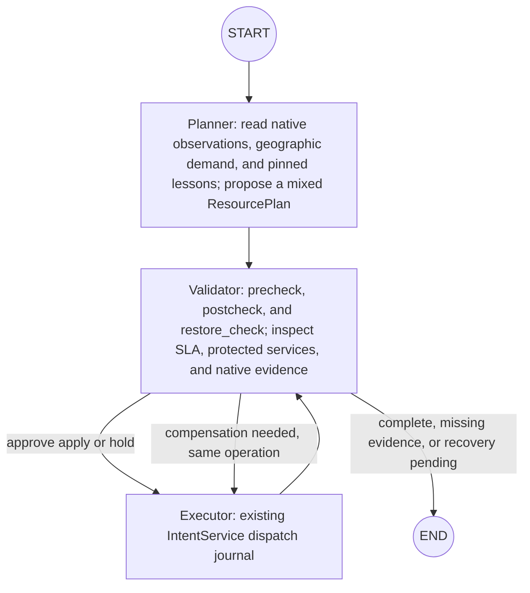

# On-prem AI agents

## Model output contract

- `intents/model_contracts.py` builds one model schema from the existing `ServiceIntent`, `ResourcePlan`, `PlanAction`, and domain constants. Policy IDs and action arguments remain limited by the current round's authority and commissioned targets.
- The compiler uses Responses API `text.format` with `json_schema` and `strict: true` to return a closed intent/issues envelope. All fields are required; optional values explicitly use `null`.
- The Planner retains `ResponsesToolModel`. `propose_resource_plans` uses a strict function schema with an array of typed plans instead of hiding `ResourcePlan` inside a `plans_json` string. Local schema, domain, authority, capacity, and native guards still validate model output. Schema validity does not authorize a write.
- Refusals, incomplete responses, schema errors, and transport failures are classified separately. Only bounded response IDs, schema digests, and safe field paths are stored; raw prompts and identities are not logged.
- Bare legacy intents and `plans_json` can be parsed only by an explicit offline legacy adapter. Production model calls do not downgrade automatically. The other agents' tools retain strict schemas. `daily_trend` remains a text interface because it does not decide resource changes.
- A real API smoke run validated the compiler's strict envelope and a Planner strict-tool call without a target (zero actions). This is not new network E2E acceptance or evidence of an AI resource improvement.

## Production service control: one three-node LangGraph

Production `POST /api/onprem/scenario-rounds` intents pass through `CityIntentBridge → IntentService`. `IntentService._run` calls `graph.py:FormalIntentGraph`. The graph delegates the existing journal's planning, precheck, execution, and postcheck to the three roles. QER, UPF and application deployment, and path actions share one `ResourcePlan`, operation ID, ownership record, and compensation journal. No separate native operation engine is introduced.



The graph has only `planner`, `executor`, and `validator` nodes. Apply and restore are phases of the same Executor node.

- **Resources:** A deployment succeeds only after an independent readback of instance, Pod UID, version, and endpoint. The commissioned catalog constrains node, template, and site.
- **Paths:** A new UPF or application can count as a service improvement only with approved session, endpoint, and flow actions. The Validator checks native SMF, PDR/FAR, N6 paths, and the exact endpoint receiver window. Shorter geographic distance or `ready=true` alone is not an effect.
- **Effects:** Evaluate every intent member and protected service in a new receiver window after installation. Separately measured UL and DL keep their original clocks and are not represented as one synchronized window. Missing usable RTT or loss evidence yields `unknown`.
- **Restoration:** Restore only after failure, expiry, or explicit release. Successful runs retain the desired policy. Partial compensation keeps recovery journals and leases until the Validator independently reads back restoration. Model unavailability does not cancel deterministic cleanup obligations or replay uncertain native writes.

Formal reconciliation uses the existing entry point:

```http
POST /api/intents/{intent_id}/reconcile
Idempotency-Key: city-cycle-002
Content-Type: application/json
```

```json
{
  "control_options": {
    "allowed_actions": ["update_qos", "place_nf", "place_application", "assign_sessions", "bind_application_endpoint", "start_service_flows"],
    "constraints": {"max_total_instances": 6, "max_geographic_chain_km": 8}
  }
}
```

These fields can only narrow operator-approved capabilities; they cannot grant new authority. `placement-reconcile` delegates to the same formal service and retains its compatible `{"constraints": ...}` body. `GET /api/operations/{id}` exposes `installation_verdict`, `routing_verdict`, `sla_verdict`, `restore_status`, `pending`, and `recovery_required`. Unknown evidence is never reported as passed.

The pinned intent configuration limits authority and capacity through `budgets`, `targets`, and `capacity_profiles`. The `placement` catalog limits workloads, slots, templates, and `service_bindings`; `placement_topology` reads sites and cells from actual city inventory. `placement_mode=colocated` means logical placement on one physical node, not physical migration or measured distance latency. Unconfigured native controllers, routes, or traffic sources remain `not_configured`.

The shared graph uses `*.formal-agents.sqlite3` for checkpoints and private artifacts and freezes a lesson snapshot per operation. The Validator stores outcome summaries without raw UE or session identities in `graph_outcomes`. The operation journal is the source of truth for native dispatch and recovery; old checkpoints cannot grant new write authority.

Offline integration regression uses model and native-port doubles. **Live acceptance on a real cluster with resident traffic remains incomplete.** Passing that regression does not establish a network improvement.

### Operator configuration example

This is a fragment to merge into an existing intent configuration pinned by SHA256. Replace context, native UPF ID, nodes, and templates with verified environment values. It is not a complete launch configuration; `budgets`, `targets`, `capacity_profiles`, and the `placement` catalog are still required.

```json
{
  "placement_topology": {"context": "city-cluster", "namespace": "cityverse", "configmap": "cityverse-city-inventory"},
  "providers": {
    "applications": {"origin": "http://127.0.0.1:8793", "token_file": "/run/cityverse/controller-token", "templates": ["controlled-receiver"]},
    "service_routes": {
      "context": "city-cluster", "namespace": "cityverse",
      "journal_file": "/var/lib/cityverse/service-routes.sqlite3",
      "session_targets": {"upf-ne-1": {"native_upf_id": "commissioned-upf-ne", "container": "upf", "n6_interface": "n6"}}
    }
  }
}
```

The application controller has a separate SHA256-protected configuration (`CITYVERSE_APPLICATION_CONTROLLER_CONFIG_FILE` and `CITYVERSE_APPLICATION_CONTROLLER_CONFIG_SHA256`). Its `binding_registry` must refer to the same registry as the `journal_file` above:

```json
{
  "schema": "cityverse.application-controller/v1",
  "context": "city-cluster", "namespace": "cityverse",
  "journal": "/var/lib/cityverse/applications.sqlite3",
  "binding_registry": "/var/lib/cityverse/service-routes.sqlite3",
  "controller_token_file": "/run/cityverse/controller-token",
  "slots": {
    "video-ne-1": {"template_id": "controlled-receiver", "node_ids": ["commissioned-city-node"],
      "pod_name": "video-ne-1", "service_name": "video-ne-1", "endpoint_id": "video-ne-1", "n6_ip_cidr": "10.60.0.10/24"}
  }
}
```

Add `templates.controlled-receiver` to this controller configuration using `application_controller.controlled_receiver_template(approved_image, network_attachment="commissioned-n6", n6_ip_cidr="10.60.0.10/24")`. The approved image must use a fixed digest. This helper creates configuration; it does not deploy a Pod. N6 attachment, address, native UPF route, and NAT need configuration and native readback. Pod readiness or coordinates cannot substitute for them.

## Legacy treatment and holdout diagnostics

`LangGraphAgentLoop`, `native_runtime.py`, and the QER profile below belong to the retained diagnostic mode. Formal all-member service control uses `FormalIntentGraph` above and does not mix holdout results into formal SLA.

LangGraph manages Planner, Executor, and Validator LLM agents. Each role receives only its knowledge, phase tools, and necessary data. Native evidence checks still decide policy writes and validation outcomes. During an active scenario, the agents observe, decide, execute, and validate repeatedly, storing only verified summaries in memory.

The agent nodes and tools live in [`graph.py`](graph.py). [`roles.py`](roles.py) defines role models and tool permissions, and [`knowledge/`](knowledge/) stores role instructions. [`executor.py`](executor.py) and [`validator.py`](validator.py) handle native operations and validation. [`scenarios/`](../scenarios/) manages lifecycle and traffic measurement; [`policy/`](../policy/) provides SMF/UPF QER adapters.

Checkpoints store execution position, the evidence database stores measurements and operation proof, and memory stores retrievable summaries across rounds. The outer StateGraph has only the three agent nodes. `START` and `END` are boundaries; observation, hold, learning, and restoration occur within the roles. `validation_phase` distinguishes `precheck`, `postcheck`, and `restore_check`. Internal audit phases include `plan`, `precheck`, `apply`, `postcheck`, `restore`, `restoration`, and `learn`.

The Planner freezes the round observation, memory scenario key, and `lessons_ref` for a cycle. `search_lessons` rereads that snapshot; replay cannot replace original inputs with newly learned lessons. Historical lessons do not grant write authority. The Executor uses `execute_decision(validated_ref)` for approved apply or hold. A hold records a decision without a network write; the installed action retains ownership of active policy. The Executor restores owned policy when required, and the Validator reads it back independently. Validator terminals are `check_proposal`, `check_effect` (including `check_execution`), and `check_restoration`. Only `record_lesson` in the learn phase writes bounded summaries.

Deterministic cleanup outside the graph guarantees final cleanup even on error or cancellation. The production retain mode transfers ownership to the coordinator after a normal cycle; a pure hold still requires independent native readback. `graph_version` is **7**; checkpoints with an incompatible digest fail closed.

| File | Responsibility |
| --- | --- |
| `contracts.py` | Scenario scope, UE population, evaluation metrics, QER profiles, and change limits. |
| `graph.py` and `state.py` | StateGraph, conditional paths, and reference-only graph state. |
| `roles.py` and `knowledge/` | Responses API tool calling and role-by-phase permission checks. |
| `tool_execution.py` | Validated precheck read batches executed in parallel LangGraph branches. |
| `observations.py` | 22 read-only Planner observations across K8s, NF, slices, UPF, RAN, N6, traffic, and trends, with missing sources reported as unconfigured or unavailable. |
| `persistence.py` | Private raw evidence, stable operation intent, and per-phase metadata, separate from SQLite checkpoints. |
| `validator.py` | Check observations and proposals, independently read native QER, and compare treatment and holdout effects. |
| `executor.py` | The only agent that writes or restores policy through the QER adapter. |
| `native_observation.py` | Align ledger UE ownership, receiver windows, and actual offered load. |
| `native_runtime.py` | Sample and run the agent loop for 1–100 traffic UEs with native UPF readback and a restorable QER journal. |
| `startup.py` | Check live runtime images and QER configuration, allowing verified capacity or an explicitly unverified-capacity AI trial. |
| `memory.py` | Store verified aggregate results for matching demand, profile, and objectives without UE identities. |

The diagnostic graph currently adjusts **QER/QoS policy within an existing slice**. A 50-UE constrained fixture had one live three-agent QER and cleanup cycle on 2026-10-19; that did not verify normal load or 100-UE capacity. A resident traffic-manager idle channel and small live traffic smoke completed on 2026-10-18; neither proves 50/100-UE AI E2E. With one UE and no holdout, the result is `no_holdout` and policy is restored without claiming a comparative effect. QoS mode that preserves offered load has only offline verification.

Run routine API regression with `python test/api_regression.py --output .tmp/your-new-regression-directory`. Legacy `planner.py` and `loop.py` moved to `archive/legacy/agents/`; production startup directly assembles three `ResponsesToolModel` instances. Run subsystem tests individually when investigating their features.

Models can be set through `CITYVERSE_PLANNER_MODEL`, `CITYVERSE_EXECUTOR_MODEL`, and `CITYVERSE_VALIDATOR_MODEL`; otherwise they use the startup OpenAI client model. `CITYVERSE_AI_MAX_CYCLES` defaults to 5 and accepts 1–5. The Planner's initial input includes structured CPU and memory values, requests and limits, source times, and missing values as `null`. After evaluation, the coordinator retains verified policy and native traffic windows until cancellation, error, or queued handoff; those paths use existing QER restoration and release evidence. API regression covers five-cycle continuation, but a prior live run stopped at 2/5 cycles, so five-cycle operation and post-evaluation continuation have not been accepted live.

## Parallel Validator precheck tools

The precheck phase enables `parallel_tool_calls`. `inspect_plan`, `check_round_scope`, `check_observation_freshness`, `check_policy_capability`, and `read_native_qer` are explicitly `parallel_safe`. If every call in a batch is safe, LangGraph `Send` branches run them together, at most four at a time.

Names, arguments, call IDs, authority, and budget are checked for the whole batch before execution. Branches share one frozen before-reference and independently check live ownership. Results preserve the model's original call order. If any tool fails, the stage waits for every branch before failing; it does not start another model decision or Executor meanwhile.

`check_proposal` is a separate terminal called only after all reads complete; it rechecks current identity and native QER. Writes and terminals cannot be mixed with other tools in one batch. The freshness tool reads rows and seal together. Handlers run concurrently, while locks serialize audit, evidence, and UI target callbacks. Each call retains start, end, and duration. Read batches may run again after recovery using the same frozen cycle evidence; the outer graph owns checkpoints.

A precheck may complete with one batch read and one terminal model response, but the model can request more reads. Offline tests do not prove two live model calls or resolve third-cycle postmeasurement latency. `trafficMode` can select a budgeted functional test or a QoS experiment that retains original scenario load within operator generator limits. The Planner receives mode and requested/applied aggregates; the round SLA summary uses frozen trusted objectives separately from relative policy effect and workflow outcomes.

## NF and application placement

Production `placement-reconcile` delegates to `IntentService.reconcile → FormalIntentGraph` and shares the formal `ResourcePlan` and native journal. The detached `PlacementAgentLoop` and its checkpoints remain only for explicitly constructed offline compatibility tests, not the production control path.
